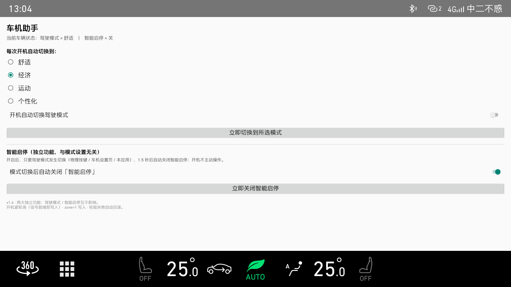

# 领克车机助手 · LynkCo ECARX Assistant

> 针对**领克（Lynk & Co）车机**（ECARX / 亿咖通 AdaptAPI 平台，Android 9）的驾驶模式与智能启停自动化小工具。
>
> ⚠️ 个人自用项目，**与领克、吉利、亿咖通（ECARX）无任何关联**，非官方产品，详见文末[免责声明](#免责声明与无关联声明)。

原车有两个让人烦的点：

1. **每次上车都要手动切一次驾驶模式** —— 车机不会记住你上次的选择；
2. **每次切驾驶模式，智能启停都会被重新打开** —— 于是每次都要再手动关一次。

这个 App 就是为这两件事写的：开机自动切到指定驾驶模式；只要驾驶模式发生变化，就自动把智能启停关掉。

## 功能

### 1. 开机自动切换驾驶模式

- 开机广播触发后拉起后台服务，采用**自适应轮询**等待车辆信号就绪：首次 0.5s，前 15 次每 1s 一次，之后 3s，再之后 15s，最多 55 次（约 2.5 分钟）。
- 写入前先读当前模式，**已经是目标值就直接跳过**，避免多余写入让车机模式服务失步。
- 写入后**读回校验**；若写入失败且模式被改成了非预期值，立即**回滚到原模式**并提示。
- 信号未就绪（读回 -1）时清空连接缓存，下一轮重新连接，而不是空转。

### 2. 模式切换后自动关闭「智能启停」

- 常驻服务通过 `registerFunctionValueWatcher` 监听驾驶模式值变化 —— **无论是物理按键、车机原生设置页还是本 App 改的，都能捕获**。
- 变化后延迟 1.5 秒关闭智能启停，失败最多补试 3 次（间隔 3 秒）。
- 关闭后还会在 6s / 15s 各**复查一次**：车辆有时会晚几秒自己把启停重新打开，发现被顶开就再关一次。
- 开机时**不**主动操作启停，只响应模式切换；开关关闭时服务自动退出。

两个功能在界面上是**完全独立**的两块，互不影响，可以只开其中一个。

### 设置界面

单选四种实车模式（舒适 / 经济 / 运动 / 个性化）+ 两个功能开关 + 「立即切换模式」「立即关闭启停」两个手动按钮，顶部实时回显当前车辆状态（读取失败会自动重试，避免显示无效值）。

界面针对车机 1920×1080 @160dpi 手写，全部使用大字号、大触控区。

## 界面截图



## 下载安装

到 [Releases](https://github.com/supreme886/lynkco-ecarx-assistant/releases) 下载 `CarAssistant-v1.6-platform.apk`（已平台签名，无需再签）：

```bash
adb connect <车机IP>:5555
adb install -r CarAssistant-v1.6-platform.apk
```

装好后打开「车机助手」，选择目标模式并打开对应开关即可。当前版本：**v1.6（versionCode 7）**，详细的 APK 功能与限制见 [发布说明](docs/release-notes-v1.6.md)。

> 若安装失败，多半是该 ROM 的平台签名与 AOSP test-keys 不一致，需要用与 ROM 同套的签名文件重新签名，见下方[构建](#构建)。

## 实测环境

- **车型**：2022 款领克 05
- **车机系统版本**：731
- 在该环境下，开机自动切换驾驶模式、模式切换后自动关闭智能启停两个功能均验证可用。

其他车型、年款或系统版本未经测试，欢迎反馈可用情况。

## 项目结构

```text
app/src/main/
├── AndroidManifest.xml              系统签名 + 开机广播 + 两个服务
├── java/com/car/assistant/
│   ├── MainActivity.java            设置界面（代码手写 UI）
│   ├── ApplyService.java            开机自动切模式（自适应轮询）
│   ├── ModeWatchService.java        常驻监听模式变化 -> 关启停
│   ├── BootReceiver.java            开机广播入口
│   ├── CarFunctionController.java   反射调用 ECARX AdaptAPI
│   └── Prefs.java                   配置持久化（SharedPreferences）
└── res/                             图标与字符串
tools/
├── build.sh                         无 Gradle 手工编译链
├── sign-platform.sh                 平台签名（需自备签名文件）
└── install.sh                       adb 安装到车机
docs/                                截图等说明材料
```

## 构建

本项目**不使用 Gradle**，用手工编译链（需要 Android SDK，默认路径 `~/Library/Android/sdk`、build-tools 37.0.0）：

```bash
# 1. aapt2 -> javac -> d8 -> apksigner(debug)
tools/build.sh

# 2. 用平台签名重新签名（sharedUserId=android.uid.system 必须平台签名才能安装）
#    需自备与你车机 ROM 同套签名的 platform.pk8 / platform.x509.pem
tools/sign-platform.sh <platform.pk8> <platform.x509.pem>

# 3. 安装到车机（默认 192.168.5.1:5555）
tools/install.sh [车机IP:端口]
```

产物：

- `build/app-debug.apk` —— debug 签名，**只能看界面**，车辆接口会因权限被拒；
- `build/CarAssistant-platform.apk` —— 平台签名，可正式安装使用。

排查日志：

```bash
adb -s <车机IP:5555> logcat -s CarAssistant
```

## 兼容性与已知限制

- 已实测环境见上方[实测环境](#实测环境)；理论上适用于其他使用 **ECARX AdaptAPI** 的领克车机，但车型/年款/OTA 版本不同，功能 ID 与模式值可能不同。
- 依赖**反射调私有 API**，车机系统升级后类名或常量变化会导致功能失效（日志 TAG 统一为 `CarAssistant`，便于排查）。
- 需要**平台签名**才能工作（`android:sharedUserId="android.uid.system"`）；签名不匹配的 ROM 上装不上，或装上后车辆接口拒绝服务。
- 实车只验证了四种模式（舒适/经济/运动/个性化），其余取值保留在代码中但未在界面暴露。
- 无自动化测试，改动需真机验证。

## 免责声明与无关联声明

**本项目由个人开发者（一名普通车主）出于自用目的独立开发，与领克（Lynk & Co）、吉利控股集团、亿咖通科技（ECARX）及其母公司、子公司、关联公司、授权经销商、4S 店、服务网点均无任何隶属、雇佣、代理、合伙、合作或授权关系。**

- 本项目**不是**上述任何一方的官方产品、官方工具或官方支持项目，**未获得**其任何形式的授权、认可、赞助、认证或技术背书；作者亦不代表上述任何一方对外发声。
- 本项目所用的车辆功能接口来自对车机系统公开可访问 API 的调用与观察，**未使用、未包含上述公司的任何私有代码、文档、SDK 或商业机密**。
- README 与代码中出现的「领克」「Lynk & Co」「吉利」「ECARX」「亿咖通」等名称及车型、系统名称，**仅用于客观说明本工具的适用车型与兼容平台**，相关商标、商号及知识产权归各自权利人所有，此处不构成任何形式的商标使用许可或权利主张。
- 本项目**仅面向个人车主自用**，请勿用于商业销售、随车交付、二次分发牟利或冒充官方渠道提供服务。

### 使用风险

修改车辆设置存在风险，请自行评估后再使用。所有操作虽通过车机自身的车辆功能接口完成，但**因使用本工具导致的任何车辆异常、设置丢失、系统故障、保修争议或人身财产损失，均由使用者自行承担**，作者不提供任何明示或暗示的担保，亦不承担任何责任。

请勿在驾驶过程中或公共道路上操作车机进行调试。刷写、改装车辆相关功能可能违反当地法规或影响整车质保，请自行确认合规性。
